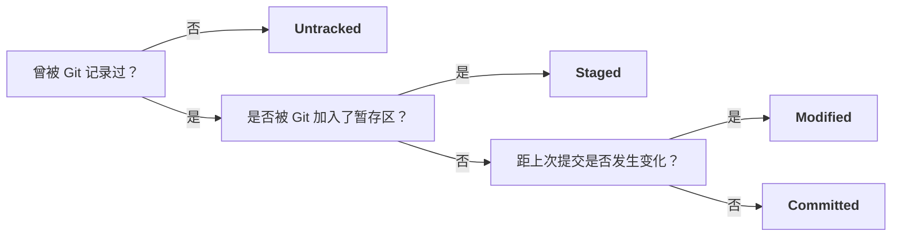

每个 Git 仓库都有一个 `.git` 隐藏文件夹，专门用于管理 Git 仓库。

Git 存储文件的地方有三个区域，分别为 **工作目录**、**暂存区**、**本地存储库**。

## 工作目录（Working Directory）

工作目录就是文件真实存在的地方，你在这里直接操作文件，进行查看、编辑、删除、创建等操作。

## 暂存区（Staging Area）

暂存区，亦称**索引（index）**，负责暂时存放**被 Git 记录，但没有提交的文件**。

这里只会存储必要的索引信息，不会全量存储文件，在下一次提交后会被清除。

## 本地存储库（Local Repository）

本地存储库位于 `.git` 目录中。在提交后，暂存区的内容会写入本地存储库。

本地存储库会保存追踪的文件的具体内容，不过对于内容相同的文件只会留存一份副本。  
~~具体实现方式以后再讲吧，先咕咕咕。。。~~

## 文件状态

工作目录中的文件可能是以下状态之一：

- **未追踪（Untracked）**
- **已修改（Modified）**
- **已暂存（Staged）**
- **已提交（Committed）**

它们的关系如下：

在大部分支持 Git 的 IDE 中，会使用特殊颜色和字符来标记出这些状态。

例如，这是我的 VS Code 的截图：

